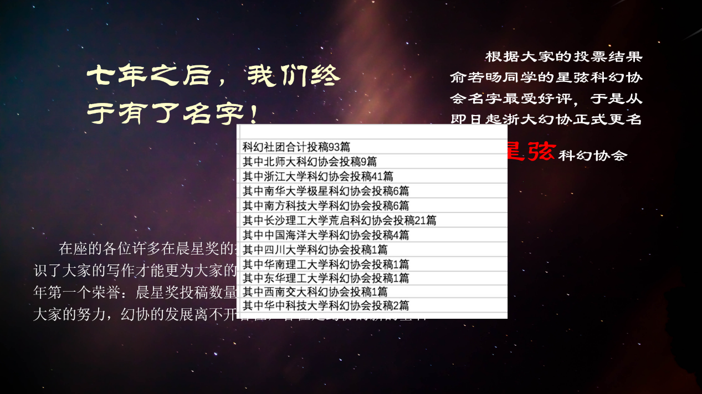

# 全员大会资料

从一张命名投票的旧截图， 读到现在大家想做的事。

本页整理所提供的《浙江大学星弦科幻协会_全员大会_重排版.pptx》，共 **18 页**，同时读取了讲者备注和页内图片。PPT 没有标明本次大会的举行日期；文件的制作时间不作为会议日期。

想快速了解协会，可以直接看[认识星弦](../../club/index.md)和[加入星弦](../../club/join.md)。这里保存图像、页码，以及与旧资料的核对结果。

## 这份大会讲了什么

| 页码 | 内容 | 网站上的去处 |
| --- | --- | --- |
| 1—3 | 协会渊源、四次重启、2016 年投票命名 | [幻协历史](../index.md)及下方命名截图 |
| 4 | 《奇点》《无限》《星途观览》、签名资料 | [社刊记录](#publications) |
| 5 | 张旭良、姜振宇、夏子健、Fate 等社员与创作线索 | 本页保留大会介绍的范围，未补写任职年表 |
| 6 | 科幻创作者来访、2009 年对谈、2023 年星矽论坛 | [交流记录](#encounters) |
| 7 | 微电影《舌尖上的流浪地球》 | [作品记录](#creations) |
| 8—9 | 文学、影视、游戏三条活动方向 | [认识星弦](../../club/index.md) |
| 10—11 | 游戏工作室、《舌尖上的太阳系》、Live2D 模型 | [作品记录](#creations) |
| 12—15 | 北斗七星分工、五个招募干员的部门 | [负责人及分工](../../club/contacts.md) |
| 16 | 灵活协作、每周晚间内训 | [加入星弦](../../club/join.md)与[日常管理](../../handbook/handover.md) |
| 17 | 干员问卷、登记与后续流程 | [干员报名入口](../../club/join.md) |
| 18 | 大会结束语 | “祝大家在幻协待得开心，眼界一新！” |

## 七年之后，终于有了名字 {#name-vote}

第 3 页保存了一张标注为 **2016 年全员大会资料**的旧幻灯片。画面左边写着“七年之后，我们终于有了名字！”，右边说明“星弦”是大家投票后最受好评的名字，并宣布更名。

<figure class="assembly-document" markdown="1">

[{ loading=lazy }](../../static/img/assembly/2016-name-vote.png)

<figcaption>全员大会 PPT 第 3 页所嵌旧图，保留原始叠放内容；点击查看大图。</figcaption>
</figure>

这张图补上了“名字经过投票选出”的具体记录，但没有显示月日，因此仍不能据它裁定旧回顾中 **10 月 13 日与 15 日**的分歧。[原来的日期核对](../index.md)。

第 2 页把社团渊源追到 1998 年，并将 **2003、2009、2012、2016** 概括为四次重启。这是大会的简要讲法；更细的注册、重组与恢复纳新过程，保留在[历史现场](field-notes.md)。

## 三种刊物，几代人的作品 {#publications}

第 4 页并列介绍了《奇点》《无限》（《∞》）和《星途观览》，还展示了《∞》封面与标注为姬十三、刘慈欣签名的图片。

- **《奇点》**：已有旧帖保存了标注为 2003 年社刊序言的《科幻，因为我们喜欢》。[序言原帖](https://www.cc98.org/topic/5097405/1)
- **《无限》／《∞》**：PPT 写到 2011 年 1 月 10 日学术部制作社刊。不过，当天的原帖还在说明约稿和制作进度，并预计开学后做出；本站据此记为“制作中”，不把当天当成发行日。[制作进度](https://www.cc98.org/topic/3537867/1) · [2022 年重现帖](https://www.cc98.org/topic/5244547/1)
- **《星途观览》**：2025—2026 学年总结记载，2026 年 5 月将第五届星弦杯优秀作品编入第三册。[学年回顾](../annual/2025-2026.md)

## 与科幻创作者相遇 {#encounters}

第 6 页及备注列出 **2009 年 2 月 22 日刘慈欣在浙江大学的对谈**，并展示当时的照片。已有历史回顾也记载了这一天与科学松鼠会合作的活动。[起源回顾](https://www.cc98.org/topic/6417615/1)

同页还展示“全国高校星矽科幻论坛”图像，备注将日期记为 **2023 年 7 月 8 日**。已有大事记能够对应到 2023 年 7 月的论坛记录。[2022—2025 年大事记](https://www.cc98.org/topic/6363226/1)

大会同时提到郭帆、神游八方等创作者，但这一页没有逐人写明所对应的活动和日期，所以不把这些名字直接填成某一场论坛的出席名单。

第 5 页介绍了 Fate 与《我的三体》的编剧工作；备注所指的具体作品为《我的三体之罗辑传》，并列出 Fate、losia、科学执政官的编剧署名。[PPT 附带的 B 站作品页](https://www.bilibili.com/bangumi/media/md28223558)

## 文学、影视与游戏 {#activities}

第 8—9 页将活动分为三条方向：**科幻文学、科幻影视、科幻游戏**。文学部分包括征文、坐而论道、阅读星空和虚拟读书会；影视部分包括社团观影与集体观影；游戏部分是独立开发与比赛。

其中，“虚拟读书会”在第 9 页被简写成“参与线上的阅读与讨论”，与已有通知不符。首期与第二期规则都围绕虚构图书、分组写书评展开，第二期更明确写出 **西 1-216** 的线下地点。网站沿用具体通知中的玩法和地点。[第二期活动档案](../../events/2026/virtual-reading-02.md) · [首期规则](https://www.cc98.org/topic/6508433/1)

## 微电影、游戏与虚拟形象 {#creations}

| 作品或项目 | 大会中的记录 | 对照与说明 |
| --- | --- | --- |
| 《舌尖上的流浪地球》 | 第 7 页：2019 年下半年制作，2020 年参加科幻拜年祭 | 与[2021 年转发帖](https://www.cc98.org/topic/5024932/1)中的节目介绍衔接；该帖提供视频入口 |
| 《舌尖上的太阳系》 | 第 10 页：展示 ChinaJoy 参展照片 | 照片没有标注参展年份、届次；[年度总结](../annual/2025-2026.md)另记载进入 2026 网易 MINIGAME 决赛名单 |
| 工作室参赛 | 第 10 页：提及鹰角开拓芯、网易 MINIGAME 等比赛 | 大会没有列出全部作品与奖项的对应关系，因此不据“佳绩”补写具体奖名 |
| Live2D 与 VUP | 第 11、15 页：展示模型，并介绍 VUP 小组 | 与游戏工作室、AI 绘画、AI 机器人小组同属玉衡的技术方向 |

参展照片和模型图已放到[认识星弦](../../club/index.md)，均直接提取自这份 PPT，保留原图。

## 部门与干员招募 {#departments}

第 12—15 页将 **天璇、天权、天玑、玉衡、开阳**列为招募干员的部门；**天枢**是社长层，**摇光**是普通社员，两者不接收干员报名。

这次补全了容易混淆的几处分工：**B 站账号由玉衡运营，微信公众号与 CC98 官号由开阳运营；天璇负责对外合作和对外活动的行政事务，天权负责校内活动的策划、实施与善后；天玑负责财务、图书与物料。** [查看完整表格](../../club/contacts.md)。

骨干手册中的五个部门说明也已更新：[天璇](../../handbook/departments/outreach.md)、[天权](../../handbook/departments/events.md)、[天玑](../../handbook/departments/finance.md)、[玉衡](../../handbook/departments/technology.md)、[开阳](../../handbook/departments/publicity.md)。旧文的“天玑（行政）”标题改为财务与物料，玉衡补齐四个技术方向，开阳补入写作与共创。

第 16 页说明部门可在统筹协调下灵活调整，并介绍每周晚间内训。第 17 页列出的干员流程为问卷、信息登记、人脸录入；二维码已解析成[可点击的腾讯问卷入口](https://wj.qq.com/s2/28026822/16uh/)，网站只提供跳转。2026 年 10 月 4 日只读核对时，页面标题为“干员纳新表”，列有工作倾向问题，并在姓名等信息一栏注明用于门禁设置；本次没有填写或提交问卷。

## 还有哪些地方没有直接照搬 {#corrections}

| 原资料中的说法 | 网站处理 |
| --- | --- |
| 讲者备注中的“浙江省现存唯一的科幻社团”等排他性说法 | 未给出调查范围和时间，协会介绍使用“浙大的科幻社团” |
| “28 年历程” | 作为从 1998 年渊源讲起的回顾，不写成同一个组织连续运作 28 年 |
| 重排文件的制作日期 | 不据此推断全员大会日期，也不新造一条会议通知 |
| 人脸录入 | PPT 未写办理详情；问卷将姓名等信息注明用于门禁设置，后续录入安排仍看群通知 |
| 具体负责人及每周内训时间 | PPT 未列出当届姓名与星期几，不据此填补名单或虚构日程 |

[认识星弦](../../club/index.md) · [加入星弦](../../club/join.md) · [回到历史总览](../index.md)
