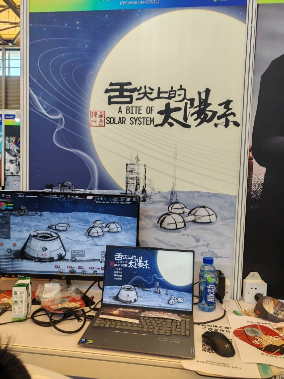
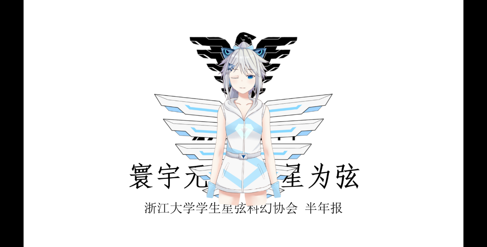

# 认识星弦

一起读科幻、看电影， 也试着写出、做出自己的世界。

星弦是浙大的科幻社团。有人喜欢小说，有人爱看电影，也有人在做游戏、折腾虚拟形象。来参加活动、在群里聊聊都可以；想一起把活动办起来，也欢迎成为干员。

[怎么加入](join.md){ .md-button .md-button--primary }
[最近有什么活动](../events/calendar.md){ .md-button }

## 平时都玩些什么

- **科幻文学**

    读别人的故事，也写自己的。星弦杯、果核杯征文之外，还有“坐而论道”科幻沙龙、“阅读星空”读书活动，以及虚拟读书会。

    [看看往期活动](../archive/annual/2025-2026.md)

- **科幻影视**

    约一间教室放电影，或一起去影院。协会也拍过微电影，把自己的脑洞搬上屏幕。

    [这次国庆放什么](../events/2026/national-day.md)

- **科幻游戏**

    独立游戏工作室一起做游戏、参加比赛。策划、程序、美术，都能在这里找到要一起解决的问题。

    [了解工作室与技术小组](contacts.md#yuheng)

“阅读星空”读真实的作品，“虚拟读书会”则先编出一本不存在的书，再为它写书评。这里的“虚拟”说的是书，不是线上会议；已有的两期通知安排的都是线下活动。[看看它怎么玩](../archive/history/anecdotes.md#unwritten-book)。

具体时间、地点请看每次活动通知。

## 我们也做过这些 {#creations}

<figure markdown="1">

[{ loading=lazy }](../static/img/assembly/solar-system-booth.jpg)

<figcaption>《舌尖上的太阳系》ChinaJoy 展位</figcaption>
</figure>

<figure markdown="1">

[{ loading=lazy }](../static/img/assembly/live2d-model.png)

<figcaption>星弦 Live2D 模型</figcaption>
</figure>

### 从《舌尖上的流浪地球》到《舌尖上的太阳系》

名字有点像，不过一个是微电影，一个是游戏。

《舌尖上的流浪地球》在 **2019 年下半年制作**，参加了 **2020 年科幻拜年祭**。[观看微电影](https://www.cc98.org/topic/5024932/1)。

游戏《舌尖上的太阳系》由星弦游戏工作室制作，进入 **2026 年网易 MINIGAME 决赛名单**，也曾参加 **ChinaJoy** 展会。上面的照片记录了工作室的展位。

### 让星弦动起来

玉衡除了游戏工作室，还有 **AI 绘画、VUP、AI 机器人**小组，并负责 B 站账号运营。上面的图是一版星弦 Live2D 模型；喜欢角色设计、技术创作或视频的同学，可以从这些方向了解起。[玉衡的具体分工](contacts.md#yuheng)。

### 写过的故事，也会留下来

《奇点》《无限》（《∞》）和《星途观览》留下了不同时期的创作：有早年社刊，也有征文作品集。2026 年，第五届星弦杯优秀作品编进了《星途观览》第三册。[翻看社刊与往期作品集](../archive/history/assembly-notes.md#publications)。

## “星弦”这个名字是怎么来的

科幻社团在浙大的渊源可以追到 1998 年前后，后来在 **2003、2009、2012、2016** 经历了四次重启。如今的名字是在 **2016 年重启后的全员大会上投票选出的**。

当年的幻灯片开头写着：“七年之后，我们终于有了名字！”[看看当年的投票记录](../archive/history/assembly-notes.md#name-vote)。

想继续往前翻，可以从[幻协历史](../archive/index.md)读起；也有[一些轶事](../archive/history/anecdotes.md)。

## 想一起做点什么

社员可以参加活动、聊天、分享作品；干员则会参与策划、宣传、技术、财务物料或外联工作。部门并不是选完就不能动，在统筹协调下，可以按兴趣和实际工作调整。

[看看加入方式和干员招募](join.md) · [查部门分工](contacts.md)
