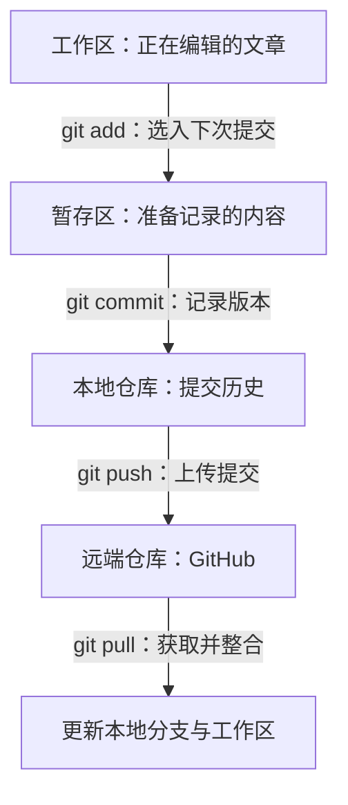

# Git 与 GitHub 原理补充

Git 记录文件的修改历史，GitHub 托管远端仓库，方便大家交换提交。只想发布文章时，先按[网站文章发布手册](publishing.md)操作；本文解释这些命令在做什么。

## 从一篇文章理解四个位置

| 名称 | 存放什么 | 以修改文章为例 |
| --- | --- | --- |
| 工作区 | 电脑上正在编辑的文件 | 在 VS Code 中修改并保存 Markdown |
| 暂存区 | 已选入下一次提交的内容 | 用 `git add` 选中这次想记录的文章版本 |
| 本地仓库 | 本机的提交历史，存放在 `.git` 中 | 用 `git commit` 留下一个版本及说明 |
| 远端仓库 | GitHub 上共享的提交历史 | 用 `git push` 把本地提交推送上去 |

保存文章后，先暂存准备提交的内容，再创建本地提交，最后推送到 GitHub。保存、暂存和提交都可以在离线时完成；与 GitHub 同步需要联网。

下面的 Mermaid 只是辅助理解，前面的表格和文字已包含完整主线：



## 一个完整例子

假设你修改了 `docs/handbook/my-first-guide.md`，想记录这个版本：

```shell
git status
git add docs/handbook/my-first-guide.md
git diff --staged
git commit -m "docs: explain activity preparation"
```

`git diff --staged` 用于检查这次将提交的改动。提交成功后运行 `git log -1 --oneline`，可以看到最新提交的编号和说明；此时修改仍只在本地，尚未上传。

`git add` 暂存的是执行命令当时的内容。暂存后又修改了文章，需要再次执行 `git add`，才能把新修改也放入这次提交。暂存并不是自动持续跟随文件变化。[Pro Git 的状态说明](https://git-scm.com/book/zh/v2/Git-基础-记录每次更新到仓库)提供了更完整的例子。

## 拉取和推送如何区分

| 操作 | 方向 | 作用 |
| --- | --- | --- |
| `git clone` | 远端到电脑 | 第一次取得项目和版本记录 |
| `git pull --ff-only origin main` | 远端到本地 | 获取远端更新；可以快进时更新本地分支，否则停止 |
| `git push origin main` | 本地到远端 | 将本地 main 的提交推送到远端 |

这里 `origin` 是克隆时为远端设置的常用名称，`main` 是本仓库使用的分支。`git pull` 会先获取远端提交，再按配置与参数整合到当前分支；它不等于直接用远端文件覆盖本地文件。详见 [git-pull 官方说明](https://git-scm.com/docs/git-pull)。

两个人都从旧版本开始写作时，可能各自创建了新提交。此时同步或推送可能被拒绝，需要先处理分歧。按照发布手册联系负责人，不要把 `--force` 当作普通解决方法。

## 版本历史能帮什么忙

提交编号用于准确指出某次修改，提交说明帮助其他人理解修改原因。可以用 `git log --oneline` 查看历史，用 `git show 提交编号` 查看某次提交内容；将“提交编号”替换为实际值。

恢复单个文件、撤销某次提交、改变分支历史是不同的操作。遇到问题时先保存当前工作、明确要恢复的内容，再按负责人指导处理。

安装 Git、设置提交署名请看[本地环境安装指南](setup.md)。更多原理可按需阅读 [Pro Git 中文版](https://git-scm.com/book/zh/v2/)。
